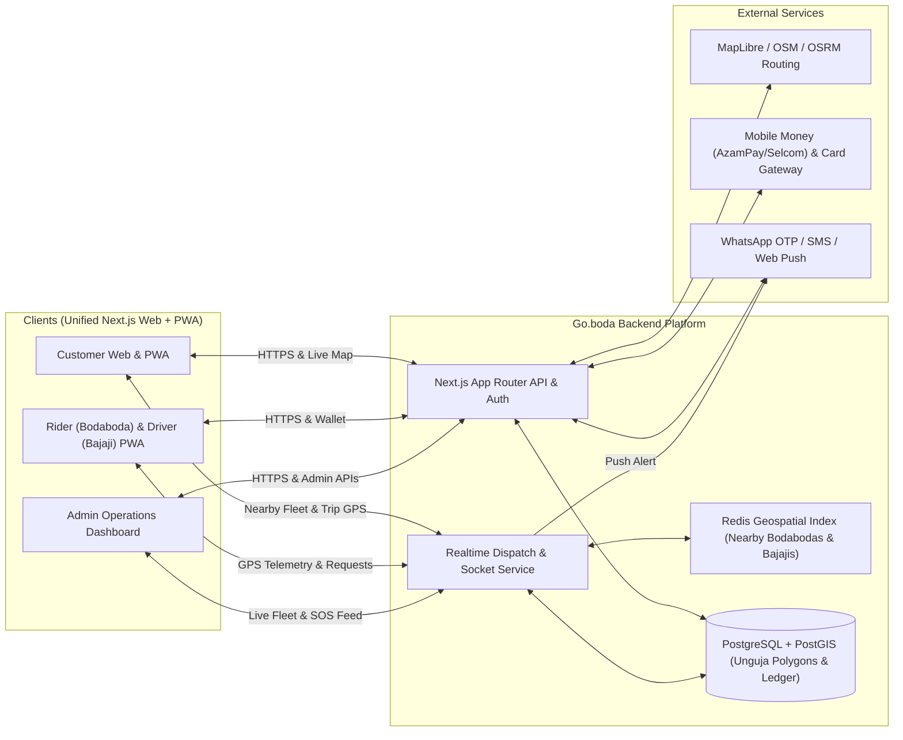
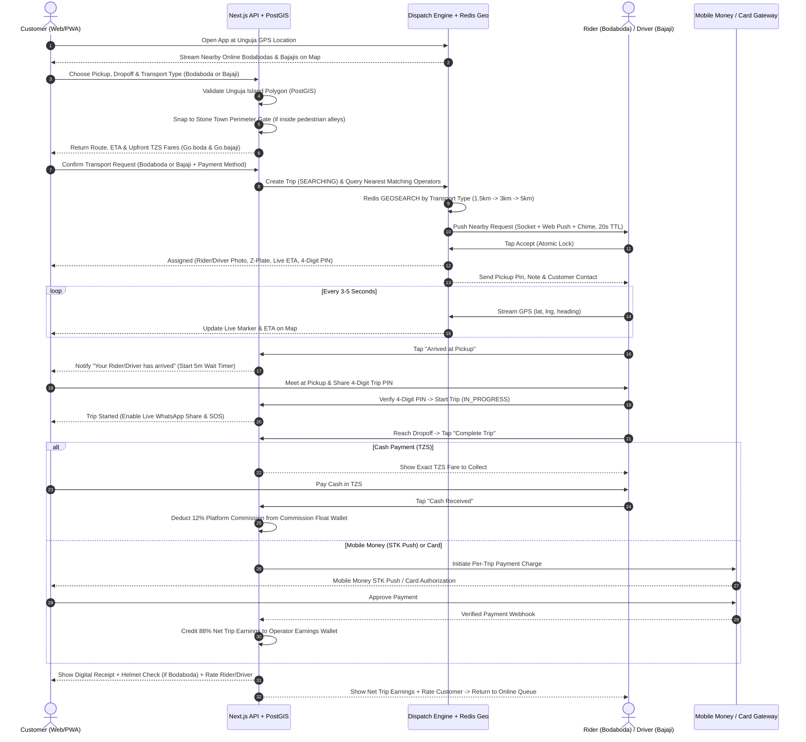
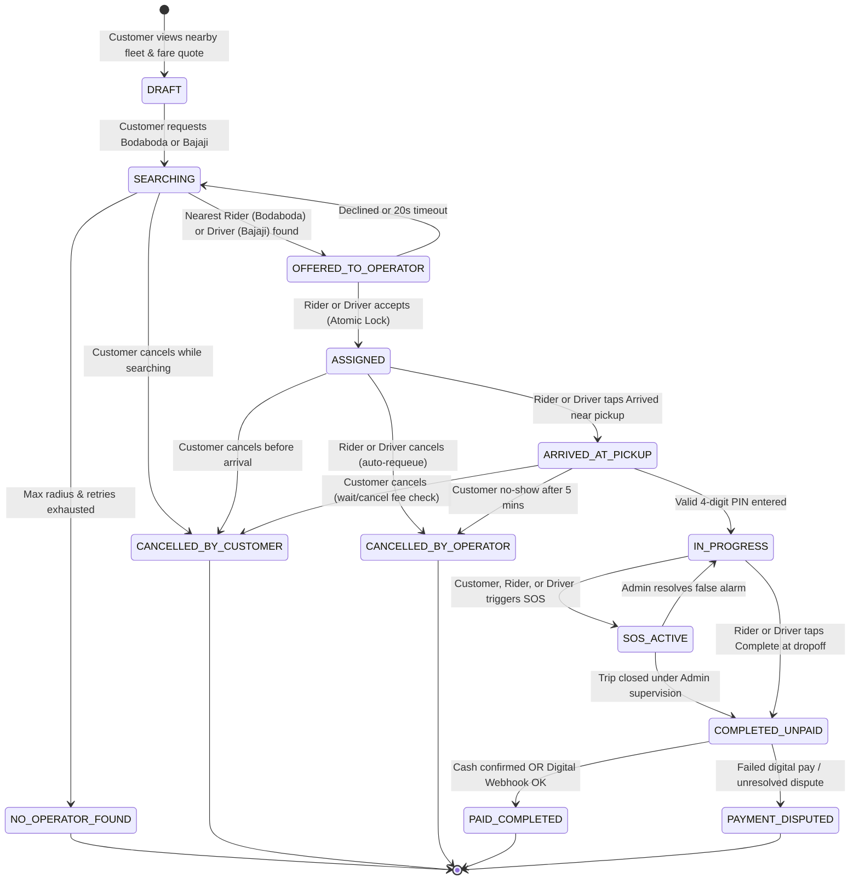
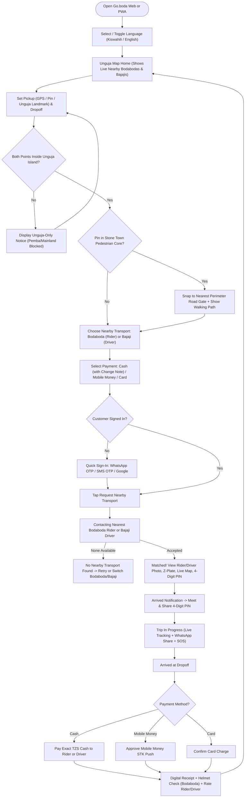
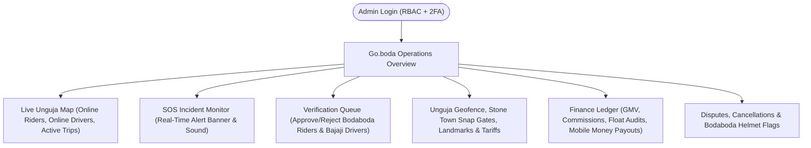
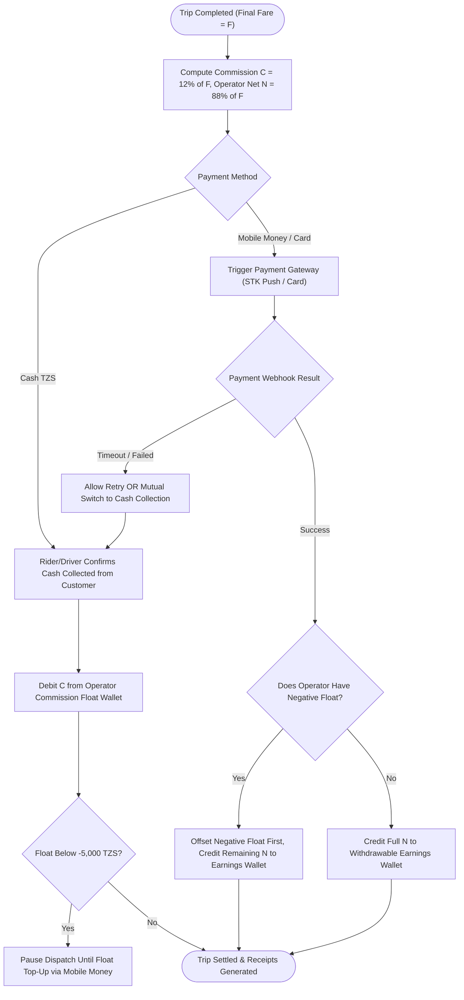

# Go.boda — App Flow & System Interaction Blueprint

> **Companion Document to:** [prd.md](file:///E:/Go.boda/prd.md) & [implementation.md](file:///E:/Go.boda/implementation.md)  
> **Scope:** End-to-end UX journeys, Mermaid architecture & flow diagrams, trip state machine, real-time nearby matching sequence, per-trip payment settlement flows, edge-case matrix, and Next.js App Router structure for **Go.boda** (Unguja Island).

---

## 1. Canonical Role & System Overview

* **Customer:** Requests nearby transport on Unguja Island (chooses either **Bodaboda** or **Bajaji**).
* **Rider:** Verified **Bodaboda** operator who receives Bodaboda requests, completes trips, and receives payment per trip.
* **Driver:** Verified **Bajaji** operator who receives Bajaji requests, completes trips, and receives payment per trip.
* **Admin:** Go.boda operations team managing KYC verification, zones, tariffs, live safety alerts, and payouts.



---

## 2. End-to-End Trip Lifecycle (Sequence Diagram)

Illustrates the complete interaction from a Customer viewing nearby Bodabodas and Bajajis on Unguja Island through matching with a Bodaboda **Rider** or Bajaji **Driver**, trip completion, and per-trip payment settlement.



---

## 3. Trip State Machine

All trip transitions are strictly validated server-side so no client can skip PIN verification, double-accept a trip, or double-settle payment.



---

## 4. Customer App Flow (Web & PWA)



### Customer Next.js Route Map
| Route | Screen / Purpose | Key Components |
| :--- | :--- | :--- |
| `/` | Unguja Live Map Home | MapLibre Unguja map, live nearby Bodaboda & Bajaji icons, SW/EN switcher, "Where to?" sheet |
| `/auth` | Customer Sign-In | WhatsApp/SMS OTP input, Google/Email sign-in, Profile name & language preference |
| `/book` | Request & Fare Confirmation | Landmark autocomplete, Stone Town perimeter snap alert, Bodaboda vs Bajaji selector, TZS fare & payment mode |
| `/trips/[id]` | Live Trip Tracker | Live Rider/Driver GPS stream, 4-digit PIN display, bilingual quick-chat, Call/WhatsApp button, Share Trip & SOS |
| `/trips/[id]/receipt` | Payment, Receipt & Review | Payment status, TZS trip breakdown, Bodaboda helmet check, 5-star rating & optional tip |
| `/track/[shareToken]` | Public Shared Trip View | Read-only live tracking page opened via shared WhatsApp/SMS link |
| `/history` | Customer Trip History | Past Bodaboda & Bajaji rides, downloadable receipts, quick rebook |
| `/profile` | Account & Safety Settings | Saved Unguja places, Emergency Contact, Language, Payment methods |

---

## 5. Rider (Bodaboda) & Driver (Bajaji) PWA Flow

The `/partner` portal dynamically renders **Rider** terminology/checklists for Bodaboda accounts and **Driver** terminology/guidance for Bajaji accounts.


### Rider & Driver Next.js Route Map (`/partner`)
| Route | Screen / Purpose | Key Components |
| :--- | :--- | :--- |
| `/partner/onboarding` | Multi-Step KYC Registration | Bodaboda Rider vs Bajaji Driver selector, camera document uploads, *Kituo* & Mobile Money payout setup |
| `/partner/home` | Shift Control & Status | High-contrast sunlight Online/Offline switch, Today's TZS earnings, Float balance badge, GPS status |
| `/partner/trip/[id]` | Active Job Console | 20s request overlay, pickup/dropoff landmarks, Google Maps launcher, PIN keypad, Cash/Digital payment screen |
| `/partner/earnings` | Trip Earnings History | Daily/Weekly breakdown of completed trips, gross fares, commissions, cash vs digital totals |
| `/partner/wallet` | Wallet & Payouts | **Earnings Wallet** (1-tap Mobile Money withdrawal) + **Commission Float** (STK Push top-up) |
| `/partner/profile` | Profile & Documents | Vehicle & Z-plate details, License/Insurance expiry reminders, Language (SW/EN), Support shortcut |

---

## 6. Admin Operations Dashboard Flow (`/admin`)



### Admin Next.js Route Map
| Route | Purpose |
| :--- | :--- |
| `/admin` | Executive dashboard (live trips, online Bodaboda Riders, online Bajaji Drivers, daily GMV, open SOS alerts) |
| `/admin/live-map` | Fullscreen Unguja map with filters by Bodaboda/Bajaji and clickable trip telemetry |
| `/admin/operators` | Rider & Driver KYC approval queue, active directory, document expiry alerts, suspend/reactivate |
| `/admin/trips` | Searchable trip list, route playback, manual cancellation/dispute resolution |
| `/admin/zones` | Unguja polygon viewer, Stone Town snap gates editor, curated landmarks manager, Bodaboda & Bajaji tariff rules |
| `/admin/finance` | Double-entry commission ledger, Rider/Driver wallet overview, Mobile Money payout logs |
| `/admin/sos` | Active & historical SOS incidents, emergency contact actions, resolution log |

---

## 7. Nearby Discovery, Matching & Pricing Backend Pipeline

1. **Live Nearby Map Feed (Pre-Booking):**
   * Customer app sends current Unguja `(lat, lng)` -> Backend runs Redis `GEOSEARCH` on both `operators:online:BODABODA` and `operators:online:BAJAJI` within a `4 km` radius -> returns anonymized vehicle markers + approximate ETA for each transport type.
2. **Geofence & Stone Town Perimeter Snap (PostGIS):**
   * Confirm `ST_Contains(unguja_polygon, pickup)` and `ST_Contains(unguja_polygon, dropoff)`.
   * If `ST_Contains(stone_town_pedestrian_polygon, pickup)` is true, snap pickup to the closest `SnapPoint` perimeter gate and compute walking distance.
3. **Fare Calculation:**
   * Fetch driving route distance & duration from OSRM / Mapbox Directions.
   * Compute upfront fare in TZS using `TariffConfig` for the chosen type (`BODABODA` or `BAJAJI`), rounded to nearest `500 TZS`.
4. **Targeted Nearby Dispatch (Redis + DB):**
   * Query Redis `GEOSEARCH` strictly for the Customer's chosen pool (`operators:online:BODABODA` -> **Riders**, or `operators:online:BAJAJI` -> **Drivers**).
   * Expanding search tiers: **Tier 1:** `1.5 km` -> **Tier 2:** `3.0 km` -> **Tier 3:** `5.0 km` (up to `6.0 km` in lower-density coastal zones).
   * Filter out operators who are busy on a trip, stale (`lastSeenAt > 45s`), already declined this trip, or below the Commission Float minimum threshold.
5. **Sequential Scored Offer & Atomic Lock:**
   * Rank nearby candidates by: **Proximity (60%)** + **Rating & Safety Score (25%)** + **Idle Fairness (15%)**.
   * Push offer to Candidate #1 via WebSocket + Web Push with a **20-second TTL**.
   * On Accept: execute an atomic Redis/DB lock transitioning `Trip` to `ASSIGNED` and generating the **4-digit Start PIN**.
   * On Decline or 20s Timeout: automatically advance to Candidate #2 (up to 6 candidates or 90 seconds total before returning `NO_OPERATOR_FOUND`).

---

## 8. Per-Trip Payment & Wallet Settlement Flow



---

## 9. Edge Cases & Recovery Matrix

| Scenario | Expected System Handling |
| :--- | :--- |
| **Customer outside Unguja (Pemba / Mainland)** | PostGIS check rejects booking with a clear notice: *"Go.boda currently operates exclusively on Unguja Island, Zanzibar."* |
| **Pin inside Stone Town pedestrian alley** | Auto-snaps to closest drivable perimeter gate, displays walking time to Customer, and shows exact gate name to the Rider/Driver. |
| **No Bodabodas nearby, but Bajajis are nearby** | Suggests 1-tap switch: *"No Bodaboda Riders nearby right now — a Bajaji Driver is 3 mins away."* (And vice versa.) |
| **Cellular 3G drop mid-trip** | PWA caches active trip state and GPS points in IndexedDB; resyncs cleanly on reconnect without dropping the screen. |
| **Mobile Money STK Push fails/times out** | Customer can tap *"Retry Payment"* or both parties confirm switching the trip to **Cash (TZS)**. |
| **Customer no-show at pickup** | After 5 minutes in `ARRIVED_AT_PICKUP`, Rider/Driver unlocks *"Cancel (Customer No-Show)"* with zero penalty. |
| **Two operators tap Accept simultaneously** | Atomic lock awards trip to first commit; second operator sees *"Trip already accepted"* and stays online. |
| **Rider/Driver cancels after accepting** | Trip automatically returns to `SEARCHING` for the next closest Rider/Driver without making the Customer rebook. |
| **SOS button triggered mid-trip** | Creates `SafetyAlert`, raises live audio/visual alarm in `/admin/sos`, and sends live tracking link + Z-Plate to emergency contact. |

---

## 10. Proposed Full-Stack Next.js Monorepo Structure

```text
E:\Go.boda\
├── prd.md                             # Product Requirements Document
├── app-flow.md                        # App Flow & System Interaction Blueprint
├── implementation.md                  # Project Scope & Phased Implementation Plan
├── public/
│   ├── manifest.webmanifest           # PWA manifest (standalone, icons, theme colors)
│   ├── icons/                         # Adaptive PWA icons (192x192, 512x512, maskable)
│   └── sounds/                        # Incoming trip chime & SOS alert audio
├── prisma/
│   ├── schema.prisma                  # PostgreSQL + PostGIS models & financial ledger
│   └── seed-unguja.ts                 # Unguja boundary, Stone Town snap gates, 150 landmarks
├── src/
│   ├── app/
│   │   ├── [locale]/                  # next-intl (/sw and /en)
│   │   │   ├── (customer)/            # Customer Web & PWA (/, /book, /trips/[id], /history)
│   │   │   ├── partner/               # Bodaboda Rider & Bajaji Driver PWA (/partner/*)
│   │   │   ├── admin/                 # Admin Ops Portal (/admin/*)
│   │   │   └── track/[shareToken]/    # Public WhatsApp live trip tracking page
│   │   ├── api/
│   │   │   ├── auth/                  # WhatsApp/SMS OTP, Google OAuth, sessions
│   │   │   ├── geo/                   # Unguja polygon check, Stone Town snap, landmarks, fare quote
│   │   │   ├── nearby/                # Live nearby Bodaboda & Bajaji availability query
│   │   │   ├── trips/                 # Request, accept, arrive, PIN start, complete, cancel, SOS
│   │   │   ├── partner/               # Rider/Driver KYC, online status, GPS ping, wallet & payout
│   │   │   ├── payments/              # Mobile Money STK Push, Card checkout, HMAC webhooks
│   │   │   └── admin/                 # KYC approval, tariffs, zones, ledger, SOS management
│   │   └── sw.ts                      # Serwist Service Worker (offline cache + Web Push)
│   ├── components/
│   │   ├── map/                       # MapLibre GL Unguja map, Bodaboda/Bajaji markers, snap badge
│   │   ├── customer/                  # Nearby picker, booking sheet, PIN card, payment & SOS drawer
│   │   ├── partner/                   # Sunlight dashboard, 20s offer modal, PIN pad, wallet cards
│   │   └── admin/                     # Live map, KYC queue, tariff & landmark editors
│   ├── lib/
│   │   ├── geo/                       # PostGIS queries, Unguja polygon helpers, fare engine
│   │   ├── dispatch/                  # Redis GEOSEARCH matching engine & atomic locks
│   │   ├── payments/                  # Mobile Money (AzamPay/Selcom) & Card gateway adapters
│   │   ├── notifications/             # Web Push (VAPID), WhatsApp Cloud API, SMS fallback
│   │   └── i18n/                      # Kiswahili (sw.json) & English (en.json) dictionaries
│   └── realtime/                      # Lightweight Socket.IO server (or managed realtime bridge)
└── package.json
```
