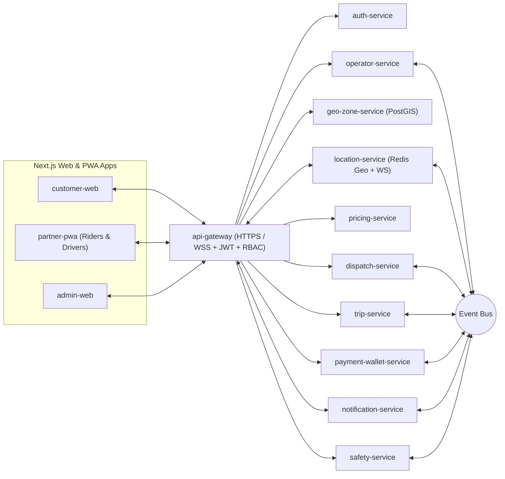
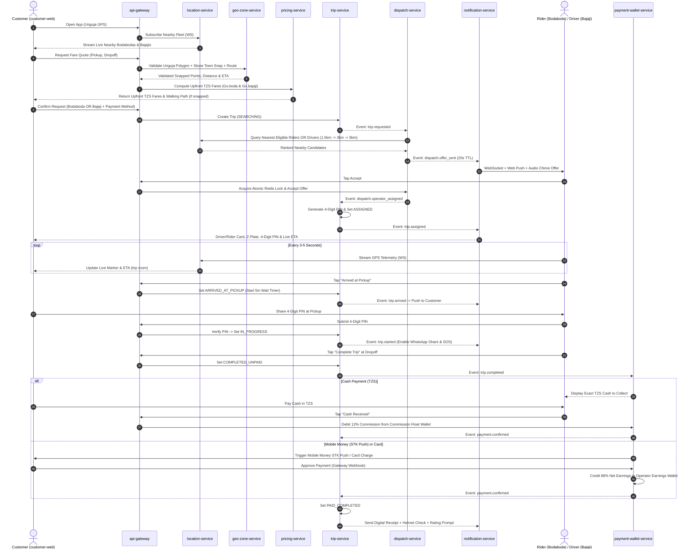
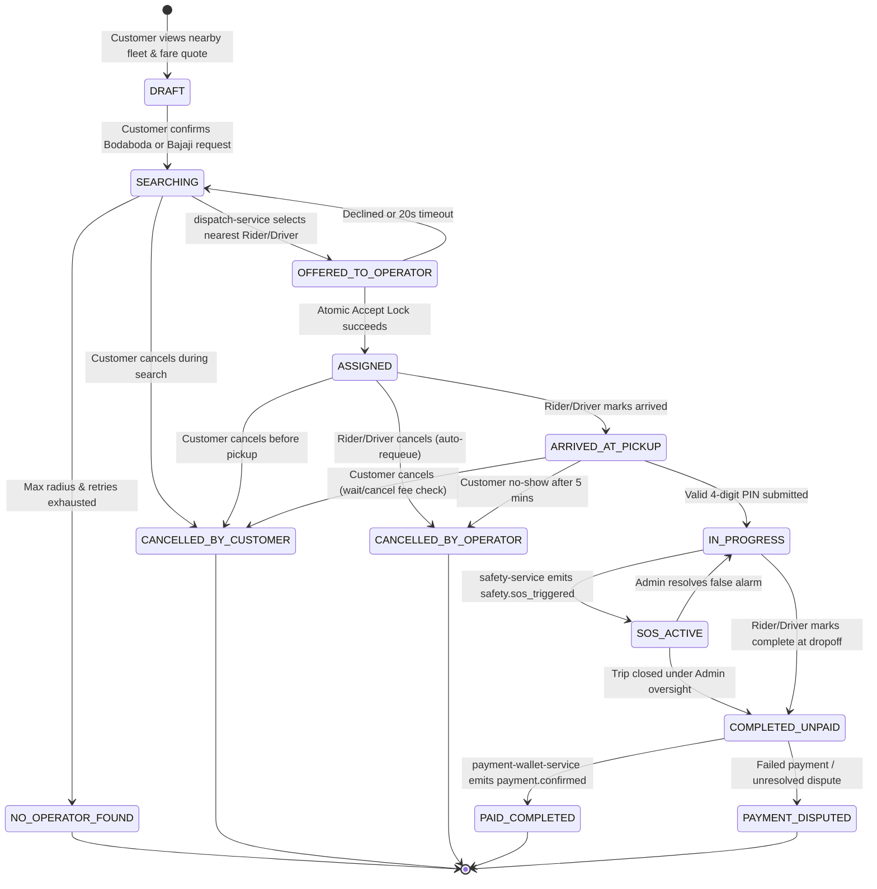
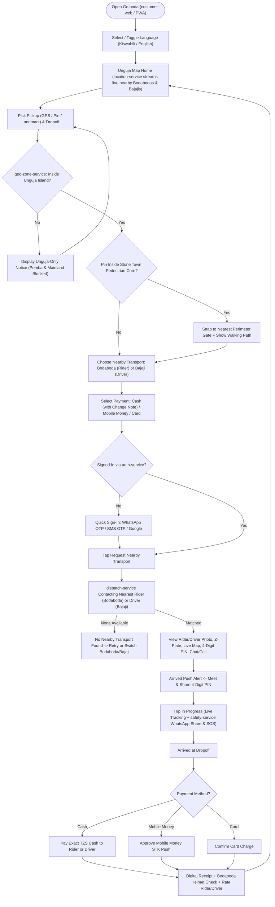
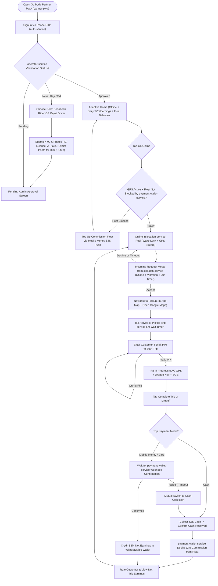
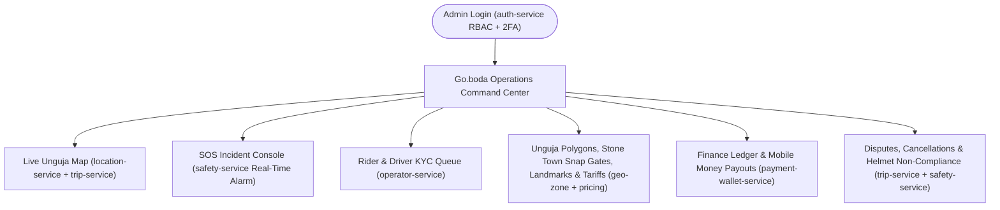
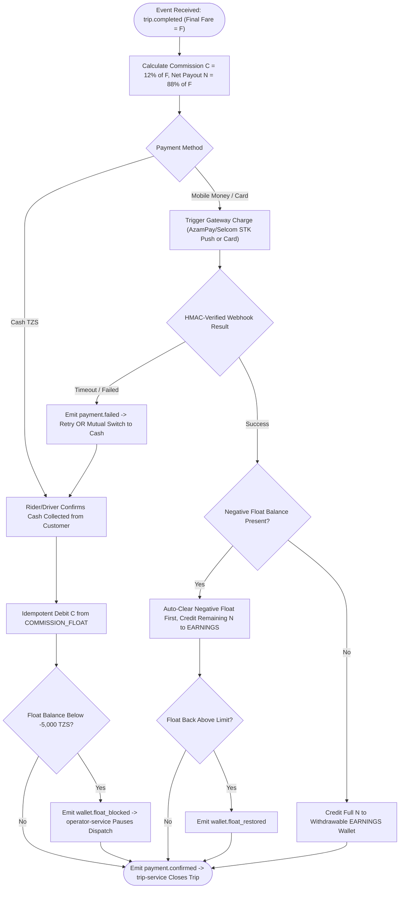

# Go.boda — App Flow & Microservice Interaction Blueprint

> **Document Version:** 2.0 (Microservices Edition)  
> **Companion Documents:** [prd.md](file:///E:/Go.boda/prd.md) | [architecture.md](file:///E:/Go.boda/architecture.md) | [implementation.md](file:///E:/Go.boda/implementation.md)  
> **Scope:** Cross-service sequence choreography, Trip State Machine, UX flowcharts for `customer-web`, `partner-pwa`, and `admin-web`, per-trip payment settlement flows, and edge-case recovery for **Go.boda** (Unguja Island).

---

## 1. Canonical Roles & Microservice Ecosystem Overview

* **Customer** (`customer-web`): Views nearby Bodabodas and Bajajis on Unguja Island and requests either transport type.
* **Rider** (`partner-pwa` — Bodaboda mode): Verified Bodaboda operator fulfilling `Go.boda` trips and earning per trip.
* **Driver** (`partner-pwa` — Bajaji mode): Verified Bajaji operator fulfilling `Go.bajaji` trips and earning per trip.
* **Admin** (`admin-web`): Operations team managing KYC, Unguja zones/tariffs, live safety alerts, and financial ledgers.

---

## 2. End-to-End Cross-Service Trip Lifecycle (Sequence Diagram)

Traces every synchronous API call (via `api-gateway`) and asynchronous Event Bus message across the 10 microservices from live nearby discovery to final Rider/Driver payout.

---

## 3. Trip State Machine (`trip-service`)

`trip-service` is the sole authority for mutating trip states; all other services react to emitted events.

---

## 4. Customer App Flow (`apps/customer-web`)

### `apps/customer-web` Route Map
| Route | Screen | Backing Microservices (via `api-gateway`) |
| :--- | :--- | :--- |
| `/[locale]` | Unguja Live Nearby Map | `location-service`, `geo-zone-service` |
| `/[locale]/auth` | Sign-In & OTP | `auth-service`, `notification-service` |
| `/[locale]/book` | Route, Stone Town Snap & Fare Quote | `geo-zone-service`, `pricing-service`, `trip-service` |
| `/[locale]/trips/[id]` | Live Trip Tracker & Safety Drawer | `trip-service`, `location-service`, `notification-service`, `safety-service` |
| `/[locale]/trips/[id]/receipt` | Payment, Receipt, Helmet Check & Rating | `payment-wallet-service`, `trip-service`, `safety-service` |
| `/[locale]/track/[shareToken]` | Public WhatsApp Shared Live Tracker | `safety-service`, `location-service` |
| `/[locale]/history` | Customer Trip History | `trip-service` |
| `/[locale]/profile` | Saved Places, Emergency Contact & Language | `auth-service`, `safety-service` |

---

## 5. Rider (Bodaboda) & Driver (Bajaji) PWA Flow (`apps/partner-pwa`)

### `apps/partner-pwa` Route Map
| Route | Screen | Backing Microservices (via `api-gateway`) |
| :--- | :--- | :--- |
| `/[locale]/onboarding` | Multi-Step Rider/Driver KYC | `operator-service`, `auth-service` |
| `/[locale]/home` | Sunlight Shift Dashboard | `operator-service`, `location-service`, `payment-wallet-service` |
| `/[locale]/trip/[id]` | Active Job Console & PIN Pad | `dispatch-service`, `trip-service`, `location-service`, `payment-wallet-service`, `safety-service` |
| `/[locale]/earnings` | Trip-by-Trip Earnings Log | `trip-service`, `payment-wallet-service` |
| `/[locale]/wallet` | Earnings Payouts & Float Top-Up | `payment-wallet-service` |
| `/[locale]/profile` | Vehicle, Z-Plate & Expiry Reminders | `operator-service`, `auth-service` |

---

## 6. Admin Operations Portal Flow (`apps/admin-web`)

---

## 7. Per-Trip Payment & Wallet Settlement Flow (`payment-wallet-service`)

---

## 8. Edge Cases & Distributed Recovery Matrix

| Scenario | Owning Service(s) | System Recovery Behavior |
| :--- | :--- | :--- |
| **Request outside Unguja (Pemba / Mainland)** | `geo-zone-service` | PostGIS `ST_Contains` fails immediately; returns clear Unguja-only message before creating a trip. |
| **Pin inside Stone Town pedestrian alley** | `geo-zone-service` | Snaps to closest perimeter `SnapPoint`, returns walking time to Customer and exact gate name to Rider/Driver. |
| **No Bodabodas nearby, but Bajajis are nearby** | `dispatch-service`, `location-service` | Suggests 1-tap switch to Bajaji (or vice versa) with live ETA. |
| **Cellular 3G drop mid-trip** | `customer-web`, `partner-pwa`, `location-service` | PWAs persist active trip state in IndexedDB and reconnect WebSockets automatically with GPS sync. |
| **Mobile Money STK Push fails/times out** | `payment-wallet-service`, `trip-service` | Emits `payment.failed`; offers 1-tap Retry or mutual confirmation to settle in Cash (TZS). |
| **Two Riders/Drivers tap Accept at once** | `dispatch-service` | Redis atomic lock (`SET NX`) awards trip to first caller; second immediately receives *"Trip already taken"*. |
| **Rider/Driver cancels after accepting** | `trip-service`, `dispatch-service` | Emits `trip.cancelled_by_operator`; `dispatch-service` auto-requeues next closest Rider/Driver seamlessly. |
| **Notification or WhatsApp provider down** | `notification-service` | BullMQ retries with exponential backoff; WhatsApp OTP falls back automatically to SMS OTP. |
| **SOS button triggered mid-trip** | `safety-service`, `notification-service` | Creates priority incident, triggers audible alarm on `admin-web`, and sends live tracking link + Z-Plate to emergency contact. |
