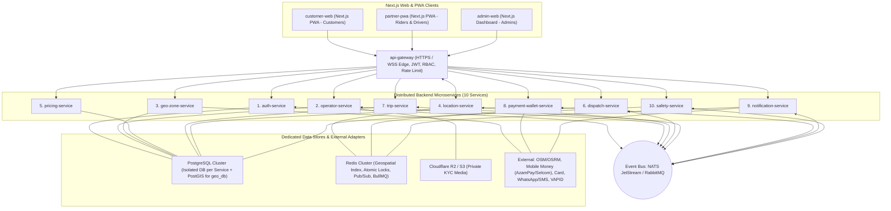

# Go.boda — Microservices Architecture Blueprint

> **Document Version:** 1.0  
> **Companion Documents:** [prd.md](file:///E:/Go.boda/prd.md) | [app-flow.md](file:///E:/Go.boda/app-flow.md) | [implementation.md](file:///E:/Go.boda/implementation.md)  
> **Pattern:** Domain-Driven Microservices (Database-per-Service) + Event-Driven Messaging + Next.js Micro-Frontend PWAs  
> **Service Area:** Unguja Island, Zanzibar (Strictly Geofenced)

---

## 1. Architectural Principles

1. **Clear Bounded Contexts:** Every Go.boda domain (Identity, Riders & Drivers, Unguja Geospatial, Live GPS, Pricing, Dispatch, Trips, Payments/Wallets, Notifications, Safety) runs as an independently deployable service.
2. **Database-per-Service:** No microservice directly reads or writes another service's database tables. Cross-service reads happen via documented internal APIs or cached read projections; cross-service workflows propagate over the **Event Bus**.
3. **Workload Isolation & Independent Scaling:**
   * High-frequency GPS ingestion (`location-service`) scales horizontally without impacting ACID financial transactions (`payment-wallet-service`).
   * Slow external providers (WhatsApp, SMS, Web Push, Payment Gateways) are isolated behind queues in `notification-service` and `payment-wallet-service`.
4. **Canonical Domain Roles:** Enforced consistently from the API Gateway down to every service:
   * `CUSTOMER` — Requests nearby Bodaboda or Bajaji transport on Unguja.
   * `BODABODA_RIDER` (**Rider**) — Operates a Bodaboda (`Go.boda`).
   * `BAJAJI_DRIVER` (**Driver**) — Operates a Bajaji (`Go.bajaji`).
   * `ADMIN` — Go.boda operations team.
5. **Monorepo Developer Velocity:** All 3 Next.js apps, the API Gateway, all 10 microservices, and shared TypeScript packages live in one **pnpm + Turborepo** repository (`E:\Go.boda`) with individual `Dockerfile`s for independent deployment.

---

## 2. System Topology Diagram



---

## 3. Frontend Distribution (3 Next.js Apps)

Each user group receives a dedicated, lightweight Next.js App Router application sharing `packages/ui`, `packages/i18n`, and `packages/shared-types`:

| App | Default Local Port | Domain Target | Purpose |
| :--- | :--- | :--- | :--- |
| **`apps/customer-web`** | `3000` | `goboda.co.tz` | Customer Web & PWA: Unguja map with nearby Bodabodas & Bajajis, booking, upfront TZS fares, live tracking, 4-digit PIN, WhatsApp share, SOS, payments, ratings |
| **`apps/partner-pwa`** | `3001` | `partner.goboda.co.tz` | Adaptive Rider & Driver PWA: Bodaboda **Rider** & Bajaji **Driver** KYC, Sunlight Mode online toggle, Wake Lock, 20s offer modal, GPS streaming, PIN start, earnings & wallet cash-out |
| **`apps/admin-web`** | `3002` | `admin.goboda.co.tz` | Operations Console: KYC verification queue, live Unguja fleet map, SOS incident room, Unguja zone/Stone Town snap/tariff managers, financial & payout audits |

---

## 4. API Gateway & Routing Contract

**Service:** `services/api-gateway` (Port `4000`, Fastify / NGINX / Kong)

* **Responsibilities:** TLS termination, JWT signature verification (via `auth-service` JWKS), role-based route protection (`CUSTOMER`, `BODABODA_RIDER`, `BAJAJI_DRIVER`, `ADMIN`), per-IP and per-user rate limiting, CORS, request correlation IDs (`x-request-id`), and WebSocket proxy upgrades to `location-service` and `notification-service`.
* **Internal Identity Forwarding:** Strips untrusted client headers and injects signed internal identity headers (`x-user-id`, `x-user-role`, `x-transport-type`) for downstream services.

| Public Route Prefix | Downstream Service | Protocol |
| :--- | :--- | :--- |
| `/api/v1/auth/*` | `auth-service` (`:4001`) | HTTP REST |
| `/api/v1/operators/*` | `operator-service` (`:4002`) | HTTP REST |
| `/api/v1/geo/*` | `geo-zone-service` (`:4003`) | HTTP REST |
| `/api/v1/nearby/*` & `/ws/location` | `location-service` (`:4004`) | HTTP REST + WebSocket |
| `/api/v1/pricing/*` | `pricing-service` (`:4005`) | HTTP REST |
| `/api/v1/dispatch/*` | `dispatch-service` (`:4006`) | HTTP REST |
| `/api/v1/trips/*` | `trip-service` (`:4007`) | HTTP REST |
| `/api/v1/payments/*` & `/api/v1/wallets/*` | `payment-wallet-service` (`:4008`) | HTTP REST + Signed Webhooks |
| `/api/v1/notifications/*` & `/ws/chat` | `notification-service` (`:4009`) | HTTP REST + WebSocket |
| `/api/v1/safety/*` & `/api/v1/track/*` | `safety-service` (`:4010`) | HTTP REST |

---

## 5. Detailed Microservice Catalog (10 Services)

### 1. `auth-service` (Port `4001`)
* **Bounded Context:** User identity, OTP login, session lifecycle, RBAC.
* **Data Store:** PostgreSQL (`auth_db`) + Redis (OTP codes with 5m TTL, refresh token blacklist).
* **Core Features:** Phone OTP initiation/verification (delegates delivery to `notification-service`), Google OAuth / Email Magic Link, RS256 JWT + rotating refresh tokens, user profile basics (`name`, `phone`, `language` [`sw`/`en`], `role`), Admin 2FA.
* **Emits:** `user.created`, `user.updated`, `user.suspended`.

### 2. `operator-service` (Port `4002`)
* **Bounded Context:** Bodaboda **Riders** & Bajaji **Drivers** onboarding, KYC, vehicle details, and eligibility.
* **Data Store:** PostgreSQL (`operator_db`) + Cloudflare R2 / S3 (private KYC bucket via presigned URLs).
* **Core Features:** Operator registration choosing `BODABODA` (**Rider**) or `BAJAJI` (**Driver**), ID/License/Plate (`Z...`)/Insurance/Helmet photo uploads, home *Kituo*, Admin approval/rejection workflow, license/insurance expiry alerts, online eligibility gate (checks `kycStatus === APPROVED` and `floatBlocked === false`).
* **Emits:** `operator.kyc_submitted`, `operator.approved`, `operator.rejected`, `operator.suspended`, `operator.availability_changed`.
* **Consumes:** `wallet.float_blocked`, `wallet.float_restored`, `trip.rated` (updates operator rating projection).

### 3. `geo-zone-service` (Port `4003`)
* **Bounded Context:** Unguja geography, Stone Town snapping, landmarks, and routing.
* **Data Store:** PostgreSQL + **PostGIS** (`geo_db`) + Redis (landmark & route cache).
* **Core Features:**
  * `POST /validate-unguja`: Hard `ST_Contains` check against the Unguja Island polygon (rejects Pemba & Mainland).
  * `POST /resolve-pickup`: Checks Stone Town pedestrian-restricted polygon and snaps interior pins to the nearest `SnapPoint` perimeter gate with walking ETA.
  * `GET /landmarks`: Autocomplete across curated Unguja landmarks/*vituo* + Unguja-bounded geocoding.
  * `POST /route`: Distance (meters), duration (seconds), and GeoJSON polyline via OSRM / Mapbox Directions.
* **Admin APIs:** Manage Stone Town snap gates, Unguja landmarks, and surge/operating zones.

### 4. `location-service` (Port `4004`)
* **Bounded Context:** Real-time GPS ingestion, nearby transport discovery, and live tracking streams.
* **Data Store:** **Redis Geospatial** (`operators:online:BODABODA`, `operators:online:BAJAJI`) + optional TimescaleDB/Postgres for trip GPS breadcrumb audit logs.
* **Core Features:**
  * WebSocket gateway receiving Rider & Driver GPS pings (`3–5s` active trip, `15s` idle online) with freshness TTL (`45s`).
  * **Live Nearby Discovery:** Answers Customer map queries with nearby online Bodaboda and Bajaji coordinates & rough ETAs.
  * Broadcasts live operator location into `trip:<tripId>` rooms (for Customer app, Admin Live Map, and public `/track/[shareToken]`).
  * Internal query endpoint `GET /internal/nearby-candidates` used by `dispatch-service`.
* **Scaling Profile:** Stateless WebSocket nodes horizontally scaled behind sticky sessions + Redis Pub/Sub adapter.

### 5. `pricing-service` (Port `4005`)
* **Bounded Context:** Fare calculation, tariff configuration, and promotional rules.
* **Data Store:** PostgreSQL (`pricing_db`) + Redis (cached active tariffs).
* **Core Features:**
  * Computes upfront TZS fare quotes for both `Go.boda` (Bodaboda) and `Go.bajaji` (Bajaji) using route distance/duration from `geo-zone-service` + active zone/time multiplier, rounded to nearest `500 TZS`.
  * Calculates final trip fare including post-5-minute wait fees and cancellation fees.
  * Admin CRUD for tariffs, night/rain surge caps (`<= 1.25x`), commission rates (`0%–15%`), and promo codes.

### 6. `dispatch-service` (Port `4006`)
* **Bounded Context:** Matching nearby Riders or Drivers to Customer requests without race conditions.
* **Data Store:** Redis (atomic distributed locks `lock:trip:<id>`, 20s offer TTLs, candidate queues) + PostgreSQL (`dispatch_db` for offer history/acceptance analytics).
* **Core Features:**
  * Strictly queries only `BODABODA` (**Riders**) for Bodaboda requests or `BAJAJI` (**Drivers**) for Bajaji requests via `location-service`.
  * Expanding radius search (`1.5km -> 3km -> 5km`, up to `6km` rural Unguja).
  * Candidate scoring: Proximity (`60%`) + Rating & Safety (`25%`) + Idle Fairness (`15%`).
  * Sequential 20-second offers with atomic Accept locking (`SET NX` + DB check) preventing double assignment.
  * Automatic failover to next candidate on decline, timeout, or post-accept operator cancel.
* **Consumes:** `trip.requested`, `trip.cancelled_by_customer`, `trip.cancelled_by_operator`.
* **Emits:** `dispatch.offer_sent`, `dispatch.operator_assigned`, `dispatch.offer_expired`, `dispatch.no_operator_found`.

### 7. `trip-service` (Port `4007`)
* **Bounded Context:** Core trip record, state machine integrity, PIN verification, receipts, and ratings.
* **Data Store:** PostgreSQL (`trip_db`).
* **Core Features:**
  * Orchestrates trip creation (calls `geo-zone-service` + `pricing-service`), locks upfront TZS fare, generates random 4-digit Start PIN on assignment.
  * Enforces server-side Trip State Machine (`DRAFT -> SEARCHING -> OFFERED_TO_OPERATOR -> ASSIGNED -> ARRIVED_AT_PICKUP -> IN_PROGRESS -> COMPLETED_UNPAID -> PAID_COMPLETED`).
  * Validates 4-digit PIN to start trip, tracks arrival wait timer, records Bodaboda helmet check, stores two-way ratings & digital receipts.
* **Emits:** `trip.requested`, `trip.arrived`, `trip.started`, `trip.completed`, `trip.cancelled_by_customer`, `trip.cancelled_by_operator`, `trip.rated`.
* **Consumes:** `dispatch.operator_assigned`, `dispatch.no_operator_found`, `payment.confirmed`, `payment.failed`, `safety.sos_triggered`.

### 8. `payment-wallet-service` (Port `4008`)
* **Bounded Context:** Per-trip payment collection, double-entry operator wallets, commission float, and payouts.
* **Data Store:** PostgreSQL (`finance_db` — strict ACID, immutable double-entry ledger).
* **Core Features:**
  * **Cash (TZS) Trips:** On Rider/Driver cash confirmation, debits `12%` commission from `COMMISSION_FLOAT`; if balance drops below `-5,000 TZS`, emits `wallet.float_blocked`.
  * **Digital Trips:** Initiates Tanzanian Mobile Money STK Push (AzamPay / Selcom / ClickPesa) or Card charge (Stripe / Flutterwave), verifies signed webhooks idempotently, auto-offsets any negative float, and credits remaining `88%` net payout to `EARNINGS`.
  * **Wallet Actions:** Mobile Money STK Push float top-up (`wallet.float_restored`) and 1-tap instant Mobile Money withdrawal from `EARNINGS`.
  * **Timeout Recovery:** Supports mutual fallback to Cash if STK Push times out.
* **Consumes:** `trip.completed`, `operator.approved` (provisions initial `EARNINGS` and `COMMISSION_FLOAT` accounts).
* **Emits:** `payment.initiated`, `payment.confirmed`, `payment.failed`, `wallet.float_blocked`, `wallet.float_restored`, `payout.completed`.

### 9. `notification-service` (Port `4009`)
* **Bounded Context:** All push, WhatsApp, SMS, and in-trip messaging.
* **Data Store:** PostgreSQL (`notif_db` — VAPID push subscriptions, message logs) + Redis / BullMQ (retryable job queues).
* **Core Features:**
  * **Web Push (VAPID):** Wakes `partner-pwa` with sound/vibration for incoming 20s ride offers and alerts `customer-web` on arrival/matching.
  * **WhatsApp Cloud API & Africa's Talking SMS:** Sends OTP codes, KYC approval alerts, and emergency SOS notifications.
  * **In-Trip Quick-Chat:** Lightweight WebSocket room supporting preset Swahili/English auto-translated messages during active trips.
* **Consumes:** `auth.otp_requested`, `dispatch.offer_sent`, `trip.*`, `payment.*`, `operator.approved`, `operator.rejected`, `safety.sos_triggered`.

### 10. `safety-service` (Port `4010`)
* **Bounded Context:** Emergency SOS workflow, public trip sharing, and helmet compliance monitoring.
* **Data Store:** PostgreSQL (`safety_db`).
* **Core Features:**
  * Generates time-limited, cryptographically random `shareToken` URLs (`/track/[shareToken]`) for 1-tap WhatsApp live trip sharing (auto-expires when trip completes).
  * Handles in-trip **SOS triggers** from Customers, Riders, or Drivers: captures live GPS from `location-service`, raises real-time Admin alarm in `admin-web`, and dispatches emergency contact alert via `notification-service`.
  * Aggregates Bodaboda helmet non-compliance reports from `trip.rated` and flags repeat offenders for Admin review.
* **Emits:** `safety.sos_triggered`, `safety.sos_resolved`, `safety.helmet_flag_raised`.

---

## 6. Event-Driven Communication Matrix

| Event Name | Publisher | Subscribers | Delivery Guarantee |
| :--- | :--- | :--- | :--- |
| `auth.otp_requested` | `auth-service` | `notification-service` | At-least-once (Low latency) |
| `operator.approved` | `operator-service` | `payment-wallet-service`, `notification-service` | Transactional Outbox |
| `trip.requested` | `trip-service` | `dispatch-service` | Transactional Outbox |
| `dispatch.offer_sent` | `dispatch-service` | `notification-service` | Real-time (20s TTL) |
| `dispatch.operator_assigned` | `dispatch-service` | `trip-service`, `location-service`, `notification-service` | Transactional Outbox |
| `trip.arrived` | `trip-service` | `notification-service` | At-least-once |
| `trip.started` | `trip-service` | `safety-service`, `notification-service` | At-least-once |
| `trip.completed` | `trip-service` | `payment-wallet-service`, `safety-service`, `location-service` | Transactional Outbox |
| `payment.confirmed` | `payment-wallet-service` | `trip-service`, `notification-service` | Idempotent Outbox |
| `wallet.float_blocked` | `payment-wallet-service` | `operator-service`, `notification-service` | Transactional Outbox |
| `wallet.float_restored` | `payment-wallet-service` | `operator-service`, `notification-service` | Transactional Outbox |
| `trip.rated` | `trip-service` | `operator-service`, `safety-service` | At-least-once |
| `safety.sos_triggered` | `safety-service` | `trip-service`, `notification-service` | Priority Queue |

---

## 7. Reliability, Consistency & Security Patterns

1. **Transactional Outbox Pattern:** Critical state writes (`trip.completed`, `payment.confirmed`, `operator.approved`) write the domain row and an `outbox_events` row in the same PostgreSQL transaction so events are never lost if the broker blinks.
2. **Idempotent Event & Webhook Handlers:** Every consumer tracks `processed_event_ids`, and `payment-wallet-service` enforces unique `idempotency_key` constraints on ledger entries so duplicate gateway webhooks can never double-credit or double-debit a Rider or Driver.
3. **Atomic Dispatch Lock:** `dispatch-service` acquires a Redis `SET lock:trip:<id> <operatorId> NX PX 10000` before finalizing an Accept, eliminating double-assignments.
4. **Circuit Breakers & Fallbacks:** External OSRM/Mapbox, WhatsApp, and Mobile Money adapters use timeouts and fallbacks (e.g., WhatsApp OTP -> SMS OTP; STK Push timeout -> mutual Cash fallback; OSRM timeout -> straight-line Haversine × road factor estimate if needed).
5. **Observability:** Every request receives an `x-request-id` at `api-gateway` propagated across HTTP calls and Event Bus headers; structured JSON logs (Pino), health checks (`/healthz`, `/readyz`), and OpenTelemetry traces allow end-to-end debugging of any trip across all 10 services.

---

## 8. Monorepo & Container Layout (`E:\Go.boda`)

```text
E:\Go.boda\
├── prd.md
├── app-flow.md
├── architecture.md
├── implementation.md
├── package.json                       # pnpm workspaces + Turborepo scripts
├── turbo.json
├── apps/
│   ├── customer-web/                  # Next.js Web & PWA (Port 3000)
│   ├── partner-pwa/                   # Next.js Rider & Driver PWA (Port 3001)
│   └── admin-web/                     # Next.js Admin Portal (Port 3002)
├── services/
│   ├── api-gateway/                   # Edge Gateway & WS Proxy (Port 4000)
│   ├── auth-service/                  # Port 4001
│   ├── operator-service/              # Port 4002
│   ├── geo-zone-service/              # Port 4003 (PostGIS)
│   ├── location-service/              # Port 4004 (Socket.IO + Redis Geo)
│   ├── pricing-service/               # Port 4005
│   ├── dispatch-service/              # Port 4006 (Matching Engine)
│   ├── trip-service/                  # Port 4007 (Trip State Machine)
│   ├── payment-wallet-service/        # Port 4008 (ACID Ledger + Gateways)
│   ├── notification-service/          # Port 4009 (VAPID, WhatsApp, SMS, Chat)
│   └── safety-service/                # Port 4010 (SOS & Share Tracking)
├── packages/
│   ├── shared-types/                  # Zod schemas, DTOs, Role & Trip enums
│   ├── events/                        # Typed Event Bus publisher/consumer SDK
│   ├── i18n/                          # Kiswahili (sw) & English (en) dictionaries
│   ├── ui/                            # Shared Tailwind + shadcn/ui + MapLibre helpers
│   └── logger/                        # Shared Pino logger + OpenTelemetry helper
└── infra/
    ├── docker-compose.yml             # Local Postgres/PostGIS, Redis, NATS/RabbitMQ
    ├── postgres/init-dbs.sql          # Creates isolated DB per microservice + PostGIS
    └── nginx/                         # Reverse proxy / local TLS config
```
