# Go.boda — Project Scope & Phased Implementation Plan

> **Project Name:** **Go.boda**  
> **Companion Documents:** [prd.md](file:///E:/Go.boda/prd.md) | [app-flow.md](file:///E:/Go.boda/app-flow.md)  
> **Target Location:** Unguja Island, Zanzibar (Strictly Geofenced)  
> **Stack:** Full-Stack Next.js (App Router, TypeScript) + PWA + PostgreSQL/PostGIS + Redis Geospatial + Realtime WebSockets

---

## 1. Project Scope

### 1.1 Core Objective
Build and launch **Go.boda**, a production-ready full-stack Next.js Web and Progressive Web App (PWA) where **Customers** on Unguja Island can see and request nearby **Bodaboda** or **Bajaji** transport, and verified **Bodaboda Riders** and **Bajaji Drivers** accept nearby requests, complete trips safely, and receive payment according to each trip.

### 1.2 In-Scope Deliverables (Release 1 — MVP)
| Domain | Included Capabilities |
| :--- | :--- |
| **Customer Web & PWA (`/`)** | Bilingual UI (Kiswahili & English), WhatsApp/SMS OTP & Google auth, live nearby Bodaboda & Bajaji map, Unguja-only geofence, Stone Town perimeter snapping, curated Unguja landmark search, upfront TZS fare quotes, Bodaboda/Bajaji booking, live GPS tracking, 4-digit Trip PIN, preset chat + Call/WhatsApp, WhatsApp live trip share, SOS button, Bodaboda helmet check, Cash/Mobile Money/Card checkout, digital receipts, ratings & tips. |
| **Rider & Driver PWA (`/partner`)** | Adaptive UI for **Bodaboda Riders** and **Bajaji Drivers**, multi-step KYC registration with mobile camera uploads, Online/Offline shift toggle with Wake Lock + Web Push + chime/vibration, 20-second incoming request modal, Google Maps navigation launcher, arrival timer, 4-digit PIN start, per-trip Cash & Digital settlement, dual-balance wallet (Earnings Wallet + Commission Float), Mobile Money float top-up & instant withdrawal. |
| **Admin Portal (`/admin`)** | RBAC + 2FA login, Rider & Driver KYC approval queue, live Unguja fleet & active trip map, real-time SOS incident console, Unguja zone/Stone Town snap/landmark/tariff editors, double-entry financial ledger & payout tracking, support & helmet non-compliance monitoring. |
| **Core Backend & Realtime** | Next.js App Router API, PostgreSQL + PostGIS geospatial validation, Redis `GEOSEARCH` nearby lookup & sequential dispatch with atomic accept locks, WebSocket telemetry server, MapLibre GL + OSM + OSRM routing, payment webhook verification, Serwist PWA offline caching. |

### 1.3 Out of Scope for Release 1 (Planned for Post-MVP)
* Service outside Unguja Island (Pemba Island or Mainland Tanzania).
* `Go.parcel` on-demand package/courier delivery.
* Fleet Owner (*Mkataba / Hesabu*) multi-vehicle management dashboard.
* Scheduled future bookings & multi-stop trips.
* Native App Store builds (Capacitor Android/iOS background-GPS shell for Riders & Drivers).

---

## 2. Architecture & Environment Baseline

| Component | Baseline Choice | Notes |
| :--- | :--- | :--- |
| **App Framework** | Next.js 15+ (App Router, React 19, TypeScript) | Single full-stack codebase in `E:\Go.boda` |
| **Styling & UI** | Tailwind CSS + shadcn/ui + Lucide Icons | Mobile-first responsive + Sunlight Mode for `/partner` |
| **i18n** | `next-intl` (`sw`, `en`) | Default toggle persisted per user & cookie |
| **PWA** | Serwist (`@serwist/next`) + `web-push` | Manifest, offline shell, push notifications, Wake Lock |
| **Database** | PostgreSQL 16 + PostGIS + Prisma ORM | Geospatial polygons + ACID trip & wallet ledger |
| **Realtime & Geo** | Redis (Geospatial + Pub/Sub) + Socket.IO server | Companion lightweight Node realtime server (or Supabase Realtime / Ably) |
| **Maps & Routing** | MapLibre GL JS + OpenStreetMap + OSRM / Mapbox Directions | Low per-trip cost suitable for TZS micro-fares |
| **Auth & Messaging** | Auth.js / JWT + WhatsApp Cloud API / Africa's Talking SMS | Reliable Tanzanian OTP delivery |
| **Payments** | AzamPay / Selcom / ClickPesa (TZ Mobile Money) + Stripe / Flutterwave (Card) | Adapter pattern so gateways can be swapped cleanly |
| **Storage** | Cloudflare R2 / AWS S3 | Private presigned uploads for KYC documents |

---

## 3. Phased Implementation Plan

```mermaid
flowchart LR
    P0["Phase 0: Setup & PWA Shell (Wk 1)"] --> P1["Phase 1: DB, PostGIS & Auth (Wk 2-3)"]
    P1 --> P2["Phase 2: Unguja Map, Nearby & Fares (Wk 4)"]
    P2 --> P3["Phase 3: Realtime Dispatch & State Machine (Wk 5-6)"]
    P3 --> P4["Phase 4: Customer & Partner UI + Safety (Wk 7-8)"]
    P4 --> P5["Phase 5: Per-Trip Payments & Wallets (Wk 9)"]
    P5 --> P6["Phase 6: Admin Operations Portal (Wk 10)"]
    P6 --> P7["Phase 7: QA, PWA Hardening & Pilot Launch (Wk 11-12)"]
    P7 --> P8["Phase 8: Post-MVP Growth (Months 4+)"]
```

---

### Phase 0 — Foundation, Monorepo Setup & PWA Shell (Week 1)
**Goal:** Establish a clean, scalable Next.js codebase, local Docker infrastructure, bilingual routing, and installable PWA baseline.

* **Key Tasks:**
  1. Initialize Next.js (App Router, TypeScript, ESLint, Tailwind CSS, shadcn/ui) inside `E:\Go.boda`.
  2. Configure `next-intl` middleware and base translation dictionaries (`src/lib/i18n/sw.json` and `en.json`).
  3. Set up Serwist PWA configuration (`public/manifest.webmanifest`, `src/app/sw.ts`, adaptive icons, offline fallback screen, install prompt banner).
  4. Create local `docker-compose.yml` running **PostgreSQL 16 + PostGIS** and **Redis 7**.
  5. Configure shared UI tokens (brand palette, high-contrast Sunlight Mode for `/partner`, mobile bottom-sheet primitives).
* **Exit Criteria:** App boots locally and installs as a PWA on mobile Chrome/Safari; `/sw` and `/en` routes switch cleanly; PostGIS and Redis containers are healthy.

---

### Phase 1 — Database Schema, Unguja Geofence & Authentication (Weeks 2–3)
**Goal:** Lock down the relational/geospatial data layer, Unguja service boundaries, and secure multi-role authentication.

* **Key Tasks:**
  1. Author `prisma/schema.prisma` covering `User`, `OperatorProfile` (`BODABODA` Rider / `BAJAJI` Driver), `Zone`, `SnapPoint`, `Landmark`, `TariffConfig`, `Trip`, `TripOffer`, `WalletAccount`, `WalletTransaction`, `Rating`, and `SafetyAlert`.
  2. Create PostGIS migration and spatial indexes (`GIST`) on `Zone.geometry`, `SnapPoint`, and `Landmark`.
  3. Build `prisma/seed-unguja.ts` seeding:
     * Official **Unguja Island boundary polygon** (excluding Pemba & Mainland).
     * **Stone Town pedestrian-restricted polygon** + verified perimeter `SnapPoint` gates (Creek Road, Darajani, Forodhani edge, Malindi, Mnazi Mmoja, Shangani edge).
     * Initial **150+ Unguja Landmarks & *Vituo*** (markets, airport, ferry terminal, suburbs, beaches, clinics).
     * Default `TariffConfig` rows for `BODABODA` and `BAJAJI`.
  4. Implement Auth APIs: WhatsApp/SMS OTP verification, Google Sign-In fallback, secure HTTP-only JWT sessions, and Next.js RBAC middleware isolating Customer (`/`), Rider & Driver (`/partner`), and Admin (`/admin`) APIs.
  5. Implement presigned Cloudflare R2 / S3 upload endpoints for private KYC media.
* **Exit Criteria:** Geospatial unit tests prove points inside Unguja pass, points in Pemba/Dar es Salaam fail, and Stone Town alley pins snap accurately; all 3 roles authenticate and respect RBAC guards.

---

### Phase 2 — Unguja Interactive Map, Nearby Discovery & Fare Engine (Week 4)
**Goal:** Deliver the signature Customer discovery experience showing live nearby Bodabodas and Bajajis with instant upfront TZS fare quotes.

* **Key Tasks:**
  1. Integrate **MapLibre GL JS** locked to Unguja Island map bounds (`maxBounds`) with custom markers for nearby Bodabodas and Bajajis.
  2. Build `/api/geo/search` combining curated Unguja landmarks/*vituo* with OSM/Nominatim geocoding restricted to Unguja.
  3. Build `/api/geo/quote` integrating:
     * Unguja polygon validation (`ST_Contains`).
     * Stone Town perimeter snap check + walking distance/time notice.
     * OSRM / Mapbox Directions route distance, duration, and encoded polyline.
     * Dynamic upfront TZS fare calculation (rounded to nearest 500 TZS) for both `Go.boda` (Bodaboda) and `Go.bajaji` (Bajaji).
  4. Build `/api/nearby` querying Redis `GEOSEARCH` to return real-time nearby online Bodaboda Riders and Bajaji Drivers with estimated arrival times.
* **Exit Criteria:** Customer can open `/`, see simulated nearby Bodabodas and Bajajis moving on the Unguja map, pick any two Unguja locations, see Stone Town snap guidance when applicable, and view accurate upfront TZS fares for both options.

---

### Phase 3 — Real-Time Dispatch Engine & Trip State Machine (Weeks 5–6)
**Goal:** Build rock-solid real-time matching, GPS streaming, atomic trip acceptance, and strict server-side trip state transitions.

* **Key Tasks:**
  1. Build the realtime WebSocket service (`src/realtime/`) backed by Redis Pub/Sub and Redis Geo (`GEOADD` / `GEOSEARCH`) for:
     * Operator GPS heartbeats (`3–5s` in trip, `15s` idle online).
     * Live Customer nearby-fleet updates and active trip tracking rooms (`trip:<id>`).
     * Admin live Unguja operations channel.
  2. Implement the **Sequential Dispatch Engine** (`src/lib/dispatch/`):
     * Strictly separates `BODABODA` (**Rider**) and `BAJAJI` (**Driver**) pools.
     * Expanding radius search (`1.5 km -> 3 km -> 5 km`, up to `6 km` rural).
     * Candidate ranking (proximity + rating + idle fairness) and **20-second offer TTL**.
     * Atomic Redis/DB lock on Accept to eliminate double-booking races.
     * Automatic re-queueing on decline, timeout, or post-accept operator cancel.
  3. Build Trip Lifecycle REST APIs enforcing the Trip State Machine (`REQUEST`, `ACCEPT`, `DECLINE`, `ARRIVE`, `START_WITH_PIN`, `COMPLETE`, `CANCEL`, `SOS`).
  4. Integrate **Web Push Notifications (VAPID)** in `src/app/sw.ts` + incoming request audio chime & vibration + Screen Wake Lock hook for `/partner`.
* **Exit Criteria:** Load/concurrency test confirms two simultaneous Accept clicks grant the trip to exactly one Rider/Driver; full state transitions work end-to-end across two browser sessions in real time.

---

### Phase 4 — Customer & Partner (Rider/Driver) Core UI + Safety Suite (Weeks 7–8)
**Goal:** Complete polished, mobile-first bilingual interfaces for Customers, Bodaboda Riders, and Bajaji Drivers, including all trust and safety workflows.

* **Key Tasks:**
  1. **Customer UI (`(customer)/`):**
     * Bottom-sheet booking flow (Pickup/Dropoff, pickup note & quick chips, Bodaboda vs Bajaji cards, payment selector with Cash change helper).
     * Live matching radar, assigned Rider/Driver card (photo, Z-Plate, rating, 4-digit PIN), bilingual preset quick-chat, and 1-tap Call/WhatsApp trigger.
     * Public shareable tracking view (`/track/[shareToken]`) via 1-tap WhatsApp share.
     * In-trip SOS drawer, post-trip receipt, Bodaboda helmet confirmation prompt, 5-star rating & optional tip, trip history (`/history`).
  2. **Rider & Driver PWA (`/partner/*`):**
     * Adaptive UI branding (`Bodaboda Rider` vs `Bajaji Driver`).
     * Multi-step KYC onboarding with mobile camera compression & upload.
     * High-contrast Sunlight Mode Home screen (Online/Offline switch, earnings summary, float badge).
     * Fullscreen 20-second Incoming Request Modal (distance, dropoff area, payout TZS, payment type, change alert).
     * Active trip console (Google Maps / Waze external nav button, 5-minute arrival wait timer, 4-digit PIN entry keypad, trip completion & customer rating).
* **Exit Criteria:** A Customer and a Bodaboda Rider (and separately a Bajaji Driver) can complete an entire trip from discovery -> PIN start -> live tracking -> WhatsApp share -> completion -> rating on real mobile devices in both Kiswahili and English.

---

### Phase 5 — Per-Trip Payments, Commission Float & Payout Ledger (Week 9)
**Goal:** Implement accurate, auditable per-trip financial settlement for Cash, Tanzanian Mobile Money, and Card payments.

* **Key Tasks:**
  1. Build double-entry `WalletAccount` and `WalletTransaction` service (`EARNINGS` and `COMMISSION_FLOAT` accounts per Rider/Driver) with strict idempotency keys.
  2. Implement **Cash (TZS) Settlement:** Rider/Driver confirms cash received -> `12%` commission atomically debited from `COMMISSION_FLOAT` -> automatic warning/dispatch pause if below `-5,000 TZS`.
  3. Build Payment Gateway Adapter Layer (`src/lib/payments/`):
     * **Tanzanian Mobile Money Adapter** (AzamPay / Selcom / ClickPesa): STK Push collection for Customers, Float top-up for Riders/Drivers, and Earnings payout disbursement to Mobile Money.
     * **Card Adapter** (Stripe / Flutterwave) for card checkout.
  4. Build HMAC-verified payment webhooks with timeout recovery (retry or mutual fallback to Cash).
  5. Build `/partner/wallet` and `/partner/earnings` screens showing clear cash vs digital trip breakdowns and 1-tap Mobile Money cash-out.
* **Exit Criteria:** Sandbox end-to-end tests verify accurate cent/shilling-level ledger balances across Cash trips, Mobile Money STK Push trips, automatic negative-float offsetting, and Rider/Driver withdrawals.

---

### Phase 6 — Admin Operations & Dispatch Dashboard (Week 10)
**Goal:** Empower Go.boda's Zanzibar operations team to verify Riders & Drivers, manage Unguja tariffs/zones, resolve SOS alerts, and audit finances.

* **Key Tasks:**
  1. Build **KYC Verification Queue (`/admin/operators`)** with document lightbox viewer, approve/reject reasons (notifies Rider/Driver via SMS/WhatsApp), document expiry tracking, and suspend/reactivate controls.
  2. Build **Live Unguja Operations Map (`/admin/live-map`)** displaying all online Bodaboda Riders, online Bajaji Drivers, and active trips with search/filter.
  3. Build **SOS Incident Console (`/admin/sos`)** with audible dashboard alarm, live trip coordinates, one-click phone/details view, and resolution log.
  4. Build **Zones, Landmarks & Tariffs Manager (`/admin/zones`)** to edit Bodaboda/Bajaji TZS pricing, night/rain multipliers, Stone Town snap gates, and landmarks without code redeployment.
  5. Build **Finance & Support Console (`/admin/finance`, `/admin/trips`)** with GMV/commission summaries, Rider/Driver wallet inspection, payout audit logs, and Bodaboda helmet non-compliance flags.
* **Exit Criteria:** Admin can onboard and approve a new Rider/Driver, update a Bodaboda base fare (reflected immediately in Customer quotes), monitor a live trip on the map, and acknowledge a test SOS alert.

---

### Phase 7 — QA Testing, PWA Hardening & Unguja Pilot Launch (Weeks 11–12)
**Goal:** Validate reliability under real Unguja 3G/4G conditions, pass security/performance audits, and launch a controlled pilot in Stone Town & Urban West.

* **Key Tasks:**
  1. Automated testing suite:
     * **Unit/Integration (Vitest):** Fare math, PostGIS Unguja polygon & Stone Town snap, Redis atomic dispatch locking, wallet ledger idempotency.
     * **E2E (Playwright):** Full Customer + Rider/Driver trip lifecycle across Cash and Digital flows.
  2. **PWA & Low-Network Hardening:**
     * IndexedDB persistence for active trips during brief 3G dropouts.
     * Lighthouse PWA & Performance audit (target Performance >= 85, PWA installability = Pass).
     * Battery & Wake Lock testing on popular budget Android devices (Tecno, Infinix, Samsung A-series).
  3. **Production Deployment & Observability:**
     * Deploy Next.js + Realtime server + managed PostgreSQL/PostGIS + Redis + Cloudflare R2 with SSL, automated DB backups, Sentry error tracking, and uptime alerts.
  4. **Controlled Field Pilot (Stone Town, Ng'ambo, Airport & Ferry Corridor):**
     * Onboard initial cohort of 20–30 verified Bodaboda Riders and 15–20 Bajaji Drivers (e.g., 0% launch promo commission for first 30 days).
     * Monitor match latency, GPS accuracy in Stone Town perimeters, and payment webhook success rates; fix field friction rapidly.
* **Exit Criteria:** Pilot trips complete smoothly on real Unguja roads with > 85% fulfillment rate, < 60s average urban match time, and zero financial ledger discrepancies.

---

### Phase 8 — Post-MVP Growth & Scale Roadmap (Months 4+)
1. **Island-Wide Unguja Rollout:** Dedicated Rider & Driver onboarding drives across North (Nungwi/Kendwa), East (Kiwengwa/Paje/Jambiani), and South (Fumba/Makunduchi/Kizimkazi).
2. **`Go.parcel` Delivery Mode:** On-demand parcel, food, pharmacy, and document delivery using the same Bodaboda Rider & Bajaji Driver fleet.
3. **Capacitor Android Wrapper (for `/partner`):** Package the Next.js Rider & Driver PWA in a lightweight native Android shell for rock-solid background GPS tracking and overlay ride alerts.
4. **Fleet Owner Portal:** Dedicated portal for vehicle owners managing *mkataba* / *hesabu* Riders & Drivers.
5. **Scheduled Rides & Frequent-Customer Passes:** Pre-booked early-morning ferry/airport rides and commuter bundles.

---

## 4. Definition of Done (Release 1 Launch Checklist)

- [ ] **Geofence Verified:** Requests outside Unguja Island (Pemba / Mainland) are strictly blocked; Stone Town interior pins snap reliably to drivable perimeter gates.
- [ ] **Role & Language Precision:** Consistent terminology everywhere (`Customer`, `Bodaboda Rider`, `Bajaji Driver`) with complete Kiswahili and English translations.
- [ ] **Atomic Dispatch Verified:** Zero duplicate trip assignments under concurrent Rider/Driver accepts.
- [ ] **Safety Features Active:** Mandatory 4-digit PIN start, Bodaboda helmet check, WhatsApp live trip share, and live Admin SOS alert verified end-to-end.
- [ ] **Financial Accuracy:** Cash commission float deductions, Mobile Money STK Push webhooks, negative-float auto-offsetting, and instant Rider/Driver payouts reconcile with zero drift.
- [ ] **PWA & Mobile Ready:** Installable on Android & iOS, Wake Lock & Web Push working on `/partner`, graceful 3G reconnect tested on field devices.
- [ ] **Security & Compliance:** RBAC audited across all `/api/*` routes, KYC files private behind signed URLs, webhook HMAC verification active, automated daily DB backups enabled.

---

## 5. Recommended Execution Team Structure

| Role | Responsibility |
| :--- | :--- |
| **Full-Stack Next.js Engineer (Lead)** | App Router frontend/backend, Prisma + PostGIS schema, Dispatch & Payment APIs, PWA configuration |
| **Frontend / UI Engineer (Optional if 2+ devs)** | MapLibre GL UX, Customer booking flow, Sunlight Mode `/partner` UI, Admin dashboard, Swahili/English i18n |
| **Local Unguja Operations Lead** | Curating landmarks & Stone Town snap gates, onboarding *vituo* Bodaboda Riders & Bajaji Drivers, field testing & pilot support |

*(A strong solo full-stack engineer can execute Phases 0–7 in ~12 weeks; a 2-developer team can compress delivery to ~7–8 weeks.)*
