# Go.boda — Project Scope & Phased Microservices Implementation Plan

> **Document Version:** 2.0 (Microservices Edition)  
> **Project Name:** **Go.boda**  
> **Companion Documents:** [prd.md](file:///E:/Go.boda/prd.md) | [architecture.md](file:///E:/Go.boda/architecture.md) | [app-flow.md](file:///E:/Go.boda/app-flow.md)  
> **Target Area:** Unguja Island, Zanzibar (Strictly Geofenced)  
> **Architecture:** 3 Next.js Web/PWA Apps + API Gateway + Event Bus + 10 Distributed Microservices in a pnpm/Turborepo Monorepo

---

## 1. Project Scope

### 1.1 Core Objective
Design, build, and launch **Go.boda** on a distributed microservice architecture where **Customers** on Unguja Island discover and request nearby **Bodaboda** or **Bajaji** transport via Next.js Web/PWA, and verified **Bodaboda Riders** and **Bajaji Drivers** accept requests, complete trips safely, and receive payment according to each trip.

### 1.2 In-Scope Deliverables (Release 1 — MVP)
| Layer / Scope | Included Deliverables |
| :--- | :--- |
| **3 Next.js Web & PWA Apps** | `apps/customer-web` (Customers), `apps/partner-pwa` (adaptive Bodaboda Rider & Bajaji Driver PWA), `apps/admin-web` (Operations Dashboard) — all bilingual (`Kiswahili` & `English`). |
| **Edge & Messaging Backbone** | `services/api-gateway` (HTTPS/WSS, JWT, RBAC, rate limiting, tracing) + Event Bus (NATS JetStream / RabbitMQ) + shared `packages/*` (`shared-types`, `events`, `i18n`, `ui`, `logger`). |
| **10 Distributed Microservices** | `auth-service`, `operator-service`, `geo-zone-service` (PostGIS Unguja + Stone Town snap), `location-service` (WebSocket + Redis Geo nearby fleet), `pricing-service`, `dispatch-service` (expanding radius + atomic Accept lock), `trip-service` (State Machine + 4-digit PIN), `payment-wallet-service` (Cash TZS + Mobile Money STK Push/Payouts + Card + ACID wallets), `notification-service` (VAPID Web Push, WhatsApp, SMS, quick-chat), `safety-service` (SOS + `/track/[shareToken]` + helmet flags). |
| **Infrastructure & Ops** | Local Docker Compose (isolated Postgres DBs + PostGIS, Redis, Event Bus), individual Dockerfiles per app/service, CI/CD test pipeline, OpenTelemetry structured logging. |

### 1.3 Out of Scope for Release 1 (Deferred to Post-MVP)
* Expansion outside Unguja Island (Pemba Island or Mainland Tanzania).
* `parcel-service` (`Go.parcel` on-demand package delivery).
* `fleet-owner-service` (multi-vehicle *Mkataba / Hesabu* owner portal).
* Scheduled future rides & commuter subscription passes.
* Native App Store wrapper (Capacitor Android/iOS background-GPS build for `partner-pwa`).

---

## 2. Technology Baseline

| Component | Standard Choice |
| :--- | :--- |
| **Monorepo Orchestrator** | pnpm Workspaces + Turborepo |
| **Frontend Apps** | Next.js 15+ (App Router, React 19, TypeScript), Tailwind CSS, shadcn/ui, `next-intl`, Serwist PWA |
| **Microservices Runtime** | Node.js 22 LTS + TypeScript + Fastify + Zod validation |
| **API Gateway** | Fastify Gateway (or Kong / NGINX) with JWT JWKS & WebSocket proxy |
| **Event Bus** | NATS JetStream (or RabbitMQ) + Transactional Outbox pattern |
| **Databases** | PostgreSQL 16 (isolated database per service) + PostGIS (`geo_db`) + Prisma ORM |
| **Realtime & Caching** | Redis 7 (Redis Geo, Atomic Locks, Pub/Sub, BullMQ queues) + Socket.IO |
| **Maps & Routing** | MapLibre GL JS + OpenStreetMap + OSRM / Mapbox Directions |
| **Payments & Comms** | AzamPay / Selcom / ClickPesa (TZ Mobile Money), Stripe / Flutterwave (Card), WhatsApp Cloud API, Africa's Talking SMS, VAPID Web Push |
| **Media & Observability** | Cloudflare R2 / AWS S3 (presigned KYC uploads), Pino JSON logs, OpenTelemetry, Sentry |

---

## 3. Phased Implementation Plan

```mermaid
flowchart LR
    P0["Phase 0: Monorepo, Gateway & Infra (Wk 1)"] --> P1["Phase 1: Auth, Operator & Geo Services (Wk 2-3)"]
    P1 --> P2["Phase 2: Location, Pricing & Map UI (Wk 4)"]
    P2 --> P3["Phase 3: Trip, Dispatch & Notif Services (Wk 5-6)"]
    P3 --> P4["Phase 4: Customer, Partner & Safety Flows (Wk 7-8)"]
    P4 --> P5["Phase 5: Payment & Wallet Service (Wk 9)"]
    P5 --> P6["Phase 6: Admin Portal Integration (Wk 10)"]
    P6 --> P7["Phase 7: E2E QA, PWA Hardening & Pilot (Wk 11-12)"]
    P7 --> P8["Phase 8: Post-MVP Services & Scale (Months 4+)"]
```

---

### Phase 0 — Monorepo, Shared Packages, API Gateway & Local Infra (Week 1)
**Goal:** Establish the Turborepo workspace in `E:\Go.boda`, shared TypeScript contracts, containerized infrastructure, `api-gateway`, and the 3 installable Next.js PWA shells.

* **Deliverables & Tasks:**
  1. Initialize pnpm Workspaces + Turborepo (`package.json`, `turbo.json`, shared ESLint/TypeScript configs).
  2. Create shared packages:
     * `packages/shared-types` (Role enums `CUSTOMER | BODABODA_RIDER | BAJAJI_DRIVER | ADMIN`, Trip states, Zod DTOs).
     * `packages/events` (Typed Event Bus client, Outbox helper, event schema contracts).
     * `packages/i18n` (Kiswahili `sw.json` and English `en.json` dictionaries).
     * `packages/ui` (Tailwind + shadcn/ui kit, Sunlight Mode tokens, mobile bottom-sheet components).
     * `packages/logger` (Pino structured logger with `x-request-id` correlation).
  3. Set up `infra/docker-compose.yml` running PostgreSQL 16 + PostGIS (with `init-dbs.sql` creating isolated databases per service), Redis 7, and NATS JetStream (or RabbitMQ).
  4. Scaffold `services/api-gateway` (port `4000`) with `/healthz`, CORS, rate limiting, and proxy config.
  5. Scaffold `apps/customer-web` (`:3000`), `apps/partner-pwa` (`:3001`), and `apps/admin-web` (`:3002`) with Serwist PWA manifests and `next-intl` (`/sw`, `/en`).
* **Exit Criteria:** `pnpm dev` / Docker Compose starts infrastructure, `api-gateway`, and all 3 Next.js apps cleanly; `customer-web` and `partner-pwa` pass PWA install checks.

---

### Phase 1 — Core Foundation Services: `auth-service`, `operator-service` & `geo-zone-service` (Weeks 2–3)
**Goal:** Deliver identity/RBAC, Rider & Driver KYC onboarding, and strict Unguja Island geospatial validation.

* **Deliverables & Tasks:**
  1. **`services/auth-service` (`:4001`, `auth_db`):**
     * Phone OTP generation/verification (Redis TTL), Google OAuth / Email fallback, RS256 JWT + JWKS endpoint for `api-gateway`, refresh token rotation, user language preference.
     * Wire JWT & RBAC guards inside `api-gateway`.
  2. **`services/operator-service` (`:4002`, `operator_db`):**
     * Bodaboda **Rider** (`BODABODA`) & Bajaji **Driver** (`BAJAJI`) onboarding models (ID, license, `Z...` plate, insurance, home *Kituo*, helmet verification).
     * Cloudflare R2 / S3 presigned upload endpoints for private KYC media.
     * Admin approve/reject/suspend endpoints emitting `operator.approved` and `operator.suspended`.
  3. **`services/geo-zone-service` (`:4003`, `geo_db` with PostGIS):**
     * Seed official **Unguja Island boundary polygon** (strictly blocking Pemba & Mainland).
     * Seed **Stone Town pedestrian-restricted polygon** + verified perimeter `SnapPoint` gates (Creek Road, Darajani, Forodhani edge, Malindi, Mnazi Mmoja, Shangani edge).
     * Seed **150+ Unguja Landmarks & *Vituo*** + build autocomplete search and OSRM/Mapbox Directions route endpoint.
* **Exit Criteria:** Automated tests confirm Unguja coordinates pass, Pemba/Dar es Salaam coordinates fail, Stone Town alley pins snap accurately, and a Rider/Driver can upload KYC and be approved via API.

---

### Phase 2 — Real-Time Nearby Discovery & Upfront Pricing: `location-service`, `pricing-service` & Unguja Map UI (Week 4)
**Goal:** Enable Customers to open `customer-web`, see live nearby Bodabodas and Bajajis on Unguja, and receive transparent upfront TZS fare quotes.

* **Deliverables & Tasks:**
  1. **`services/location-service` (`:4004`, Redis Geo + Socket.IO):**
     * WebSocket server ingesting Rider & Driver GPS heartbeats into `operators:online:BODABODA` and `operators:online:BAJAJI` with 45s staleness expiry.
     * Public/Customer nearby feed returning anonymized nearby Bodabodas and Bajajis + ETA.
     * Internal `/internal/nearby-candidates` query for `dispatch-service`.
  2. **`services/pricing-service` (`:4005`, `pricing_db` + Redis):**
     * Seed default TZS tariffs for `Go.boda` (Bodaboda) and `Go.bajaji` (Bajaji).
     * Upfront TZS fare calculator (rounded to nearest `500 TZS`), wait-time and cancellation fee rules, capped night/rain multipliers (`<= 1.25x`).
  3. **Map Integration in `apps/customer-web`:**
     * MapLibre GL JS locked to Unguja `maxBounds`, rendering real-time nearby Bodaboda and Bajaji icons, landmark search, Stone Town perimeter snap alert + walking time, and upfront TZS fare comparison cards.
* **Exit Criteria:** Simulated Bodaboda Riders and Bajaji Drivers appear moving in real time on `customer-web`, and selecting any two Unguja points displays accurate upfront TZS fares for both Bodaboda and Bajaji.

---

### Phase 3 — Core Orchestration: `trip-service`, `dispatch-service` & `notification-service` (Weeks 5–6)
**Goal:** Implement the distributed request-to-assignment saga with atomic locking, strict trip state transitions, and reliable PWA push/chime alerts.

* **Deliverables & Tasks:**
  1. **`services/trip-service` (`:4007`, `trip_db`):**
     * Trip creation (calls `geo-zone-service` + `pricing-service`), strict server-side Trip State Machine, Transactional Outbox emitting `trip.requested`, `trip.arrived`, `trip.started`, `trip.completed`, `trip.cancelled_*`, `trip.rated`.
     * 4-digit Start PIN generation & validation, 5-minute arrival wait timer, digital receipts, Bodaboda helmet check, and two-way ratings.
  2. **`services/dispatch-service` (`:4006`, Redis Locks + `dispatch_db`):**
     * Consumes `trip.requested`, queries strictly matching transport pool (`BODABODA` Riders or `BAJAJI` Drivers) with expanding radius (`1.5km -> 3km -> 5km`, up to `6km` rural).
     * Ranks candidates (proximity + rating + idle fairness), runs 20-second sequential offers, enforces atomic Accept lock (`SET NX`), and auto-requeues on decline, timeout, or post-accept operator cancel.
  3. **`services/notification-service` (`:4009`, `notif_db` + BullMQ):**
     * Web Push (VAPID) subscriptions & background PWA alerts, WhatsApp Cloud API + Africa's Talking SMS fallback (OTP & trip status), and lightweight bilingual preset quick-chat WebSocket room.
* **Exit Criteria:** Concurrency tests prove simultaneous Accept calls assign exactly one Rider/Driver; end-to-end event saga transitions a trip from `SEARCHING` through PIN verification to `COMPLETED_UNPAID` with live push/socket alerts.

---

### Phase 4 — Complete Customer, Partner (Rider/Driver) & `safety-service` Flows (Weeks 7–8)
**Goal:** Finish production-grade mobile-first UX across `customer-web` and `partner-pwa`, backed by a dedicated safety & live-sharing microservice.

* **Deliverables & Tasks:**
  1. **`services/safety-service` (`:4010`, `safety_db`):**
     * Shareable time-limited public tracking tokens (`/track/[shareToken]`).
     * In-trip SOS trigger endpoint capturing live GPS from `location-service`, emitting priority `safety.sos_triggered`, and logging resolution timelines.
     * Bodaboda helmet non-compliance counter consuming `trip.rated` and flagging repeat offenders.
  2. **Complete `apps/customer-web`:**
     * Full booking bottom-sheet (pickup notes, quick chips, Cash change helper, Mobile Money/Card selector).
     * Matching radar, assigned Rider/Driver card (photo, Z-Plate, 4-digit PIN), bilingual quick-chat, Call/WhatsApp trigger, 1-tap WhatsApp live trip share, SOS drawer, receipt, helmet check, ratings & history.
  3. **Complete `apps/partner-pwa`:**
     * Adaptive **Bodaboda Rider** vs **Bajaji Driver** UI labels & checklists.
     * Multi-step KYC mobile camera flow, Sunlight Mode Online/Offline dashboard, Screen Wake Lock, incoming 20s offer modal with audio chime & vibration, Google Maps/Waze nav launcher, PIN keypad, trip completion & Customer rating.
* **Exit Criteria:** Full mobile field walkthrough succeeds in both Kiswahili and English for both a Bodaboda trip and a Bajaji trip, including public WhatsApp live tracking and SOS alert triggering.

---

### Phase 5 — Per-Trip Payments, Wallets & Payouts: `payment-wallet-service` (Week 9)
**Goal:** Deliver an auditable, idempotent per-trip settlement system for Cash (TZS), Tanzanian Mobile Money, and Card payments.

* **Deliverables & Tasks:**
  1. **`services/payment-wallet-service` (`:4008`, `finance_db`):**
     * Immutable double-entry ledger (`WalletAccount` + `WalletTransaction`) provisioning `EARNINGS` and `COMMISSION_FLOAT` accounts when `operator.approved` arrives.
     * **Cash Settlement:** Rider/Driver confirms cash collected -> debits `12%` commission from `COMMISSION_FLOAT`; emits `wallet.float_blocked` if below `-5,000 TZS` (consumed by `operator-service`).
     * **Mobile Money Adapter (AzamPay / Selcom / ClickPesa):** Customer STK Push collection, Rider/Driver float top-up (`wallet.float_restored`), and 1-tap instant `EARNINGS` withdrawal.
     * **Card Adapter (Stripe / Flutterwave):** Card checkout + HMAC-verified idempotent webhooks + automatic negative-float offsetting before crediting withdrawable `EARNINGS`.
     * **Timeout Recovery:** Mutual fallback to Cash if digital STK Push times out.
  2. **Wallet & Earnings UI in `apps/partner-pwa`:**
     * Daily/weekly earnings breakdown (Cash vs Digital), Commission Float status bar, 1-tap Mobile Money top-up and withdrawal screens.
* **Exit Criteria:** Sandbox integration tests verify zero ledger drift across Cash trips, Mobile Money STK Push trips, duplicate webhook replays, float-block enforcement, and instant Rider/Driver payouts.

---

### Phase 6 — Operations Command Center (`apps/admin-web`) (Week 10)
**Goal:** Empower Go.boda's Zanzibar operations team to run daily platform operations across all 10 microservices from one portal.

* **Deliverables & Tasks:**
  1. **Executive Dashboard:** Live KPIs aggregated from `trip-service`, `location-service`, `payment-wallet-service`, and `safety-service`.
  2. **Rider & Driver KYC Queue:** Document viewer connected to `operator-service` (approve, reject with reason, expiry alerts, suspend/reactivate).
  3. **Live Unguja Operations Map:** Real-time online Bodaboda Riders, Bajaji Drivers, and active trips (`location-service`).
  4. **SOS Incident Room:** Real-time audible alert banner, live GPS coordinates, trip/Z-plate details, and resolution audit log (`safety-service`).
  5. **Zones, Landmarks & Tariffs Manager:** CRUD UI connected to `geo-zone-service` and `pricing-service` (live TZS tariff changes without redeployment).
  6. **Finance & Compliance Console:** GMV/commission dashboard, wallet audits, Mobile Money payout logs (`payment-wallet-service`), and Bodaboda helmet non-compliance queue (`safety-service`).
* **Exit Criteria:** Admin can approve a new Rider/Driver, edit a Bodaboda or Bajaji tariff (immediately reflected in `customer-web`), view live Unguja trips, and resolve a test SOS alert.

---

### Phase 7 — Cross-Service QA, PWA Hardening & Unguja Pilot Launch (Weeks 11–12)
**Goal:** Verify end-to-end distributed reliability, harden 3G/PWA performance, deploy containerized production infrastructure, and run a controlled Unguja pilot.

* **Deliverables & Tasks:**
  1. **Automated Testing Suite:**
     * Service unit & contract tests (Vitest) for PostGIS Unguja polygons, fare math, atomic dispatch locks, outbox publishing, and double-entry ledger idempotency.
     * Cross-service E2E tests (Playwright) running Customer + Rider/Driver + Admin flows against Docker Compose.
  2. **PWA & 3G Resilience:**
     * IndexedDB active-trip caching & seamless socket reconnect testing under simulated 3G drops.
     * Lighthouse PWA & Performance audits + field Wake Lock/chime testing on budget Android phones (Tecno, Infinix, Samsung A-series).
  3. **Production Deployment & Observability:**
     * Individual production Dockerfiles for all 3 apps and 11 backend containers (`api-gateway` + 10 services).
     * Managed PostgreSQL/PostGIS with automated daily backups, managed Redis, Event Bus, Cloudflare R2, SSL, OpenTelemetry + Sentry alerting.
  4. **Unguja Field Pilot (Stone Town, Ng'ambo, Airport & Ferry Corridor):**
     * Onboard 20–30 Bodaboda Riders and 15–20 Bajaji Drivers (0% introductory commission promo), monitor real-road GPS/Stone Town snap accuracy, and iterate quickly.
* **Exit Criteria:** Pilot achieves > 85% completion rate, < 60s average urban match time, 99.5%+ core uptime, and zero financial reconciliation errors.

---

### Phase 8 — Post-MVP Microservices & Growth Roadmap (Months 4+)
1. **Island-Wide Unguja Scaling:** Expand Rider & Driver onboarding to North (Nungwi/Kendwa), East (Kiwengwa/Paje/Jambiani), and South (Fumba/Makunduchi/Kizimkazi).
2. **`parcel-service` (`Go.parcel`):** New microservice reusing `location-service`, `dispatch-service`, and `payment-wallet-service` for instant parcel/shop/pharmacy delivery across Unguja.
3. **`fleet-owner-service`:** Portal for multi-vehicle owners tracking *mkataba* / *hesabu* Riders & Drivers.
4. **Capacitor Android Wrapper for `partner-pwa`:** Thin native shell around the existing Next.js `partner-pwa` for rock-solid background GPS and screen-overlay job alerts.
5. **Scheduled Rides & Commuter Passes:** Pre-booked airport/ferry transfers and frequent-Customer bundles.

---

## 4. Release 1 Launch Readiness Checklist

- [ ] **Microservice Isolation:** Every service runs with its own PostgreSQL database/store, `/healthz` endpoint, and Dockerfile.
- [ ] **Unguja Geofence Verified:** Pemba and Mainland Tanzania requests strictly rejected by `geo-zone-service`; Stone Town interior pins snap accurately to perimeter gates.
- [ ] **Canonical Roles & Bilingual UX:** Strict `Customer`, `Bodaboda Rider`, `Bajaji Driver`, `Admin` naming across Kiswahili and English.
- [ ] **Concurrency & Event Reliability:** Atomic Redis locks prevent double-booking; Transactional Outbox prevents lost trip/payment events.
- [ ] **Financial Accuracy:** Cash float deductions, Mobile Money STK Push webhooks, negative-float auto-offsetting, and instant withdrawals pass full ledger audit.
- [ ] **Safety Verified:** 4-digit PIN start, Bodaboda helmet check, `/track/[shareToken]` WhatsApp sharing, and `admin-web` SOS alarm verified live.
- [ ] **Security Audited:** Centralized JWT/RBAC at `api-gateway`, HMAC webhook verification, private signed R2 URLs for KYC documents.

---

## 5. Recommended Team Structure

| Role | Ownership |
| :--- | :--- |
| **Backend / Systems Engineer (Lead)** | `api-gateway`, Event Bus, `auth`, `operator`, `geo-zone`, `location`, `pricing`, `dispatch`, `trip`, `payment-wallet`, `notification`, `safety` services & Docker/CI |
| **Frontend Next.js / PWA Engineer** | `customer-web`, `partner-pwa`, `admin-web`, MapLibre GL UX, Serwist PWA, Sunlight Mode & `next-intl` (SW/EN) |
| **Unguja Operations Lead** | Curating Unguja landmarks & Stone Town snap gates, onboarding *vituo* Bodaboda Riders & Bajaji Drivers, pilot coordination & support |

*(A 2-engineer team can complete Release 1 across Phases 0–7 in ~10–12 weeks; a 3–4 engineer team can parallelize services & apps to complete in ~6–8 weeks.)*
